# Man of Substance

The official website for _Man of Substance_, my debut studio album as DVK, is a full-stack app built with SvelteKit and Supabase. Users can view a synopsis, lyrics, and credits for each track, while authenticated contributors can claim tiered rewards including track downloads.

## Links

- Repository: [github.com/DavyK17/man-of-substance](https://github.com/DavyK17/man-of-substance)
- Live site: [manofsubstance.pages.dev](https://manofsubstance.pages.dev)

## How it was built

### Base

- [SvelteKit](https://kit.svelte.dev/) - Full-stack web application framework
- [Supabase](https://supabase.com/) - Open source backend-as-a-service (BaaS)
- [TypeScript](https://www.typescriptlang.org/) - Typed JavaScript programming language

#### Testing and monitoring

- [Playwright](https://playwright.dev/) - End-to-end testing framework
- [Vitest](https://vitest.dev/) - Unit testing framework

### Supporting libraries

- [JS File Downloader](https://github.com/AleeeKoi/js-file-downloader) - JavaScript library for downloading files on the browser
- [JSZip](https://stuk.github.io/jszip/) - JavaScript library for creating, reading, and editing .zip files
- [Moment.js](https://momentjs.com/) - JavaScript time manipulation library

## Features

The site is a full-stack app with a simple design that is accessible from desktop, tablet, and mobile. Its [Lighthouse report](./readme/lighthouse.pdf) records scores of 95 in performance, 100 in accessibility, 100 in best practices, and 100 in SEO.

### Contributors

The Contributors page lists backers for the album's crowdfunding campaign. A contributor signs in with the email used during the campaign and reaches a dashboard to view and claim rewards for their tier (determined by their contribution amount), including track downloads, a personalised thank-you video where eligible, and related files.

Authentication makes an acceptable campaign-era trade-off: the server supplies a single shared password for each contributor, so knowing a backer's email is sufficient to reach their rewards. The only other data at risk includes their supplied names, email addresses, and contribution amounts, so the potential loss from a breach is limited even if the barrier for attack is low.

### Tracks and credits

The tracklist is loaded from the database, while synopses, lyrics and credits (including HTML markup) for each track all live in a single local JSON file. This decoupling establishes the database as the single source of truth, with catalogue content supplementing it exclusively to satisfy application concerns (e.g. keeping HTML markup in the frontend).

## Wireframes

### Home page

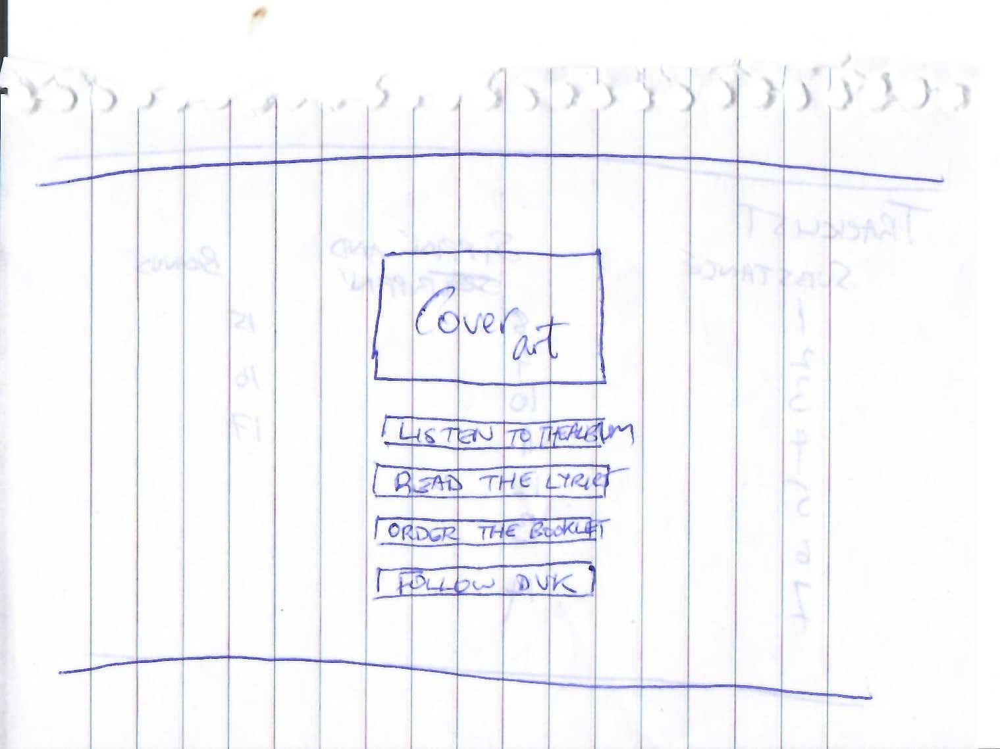

### Contributors page

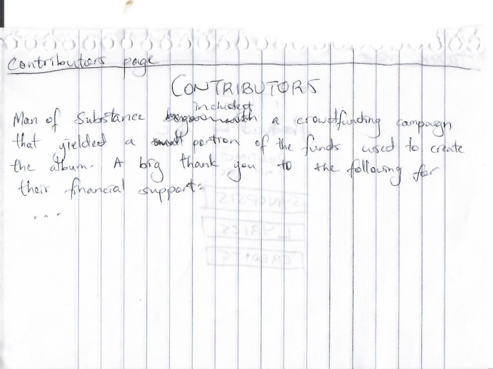

### Tracklist page

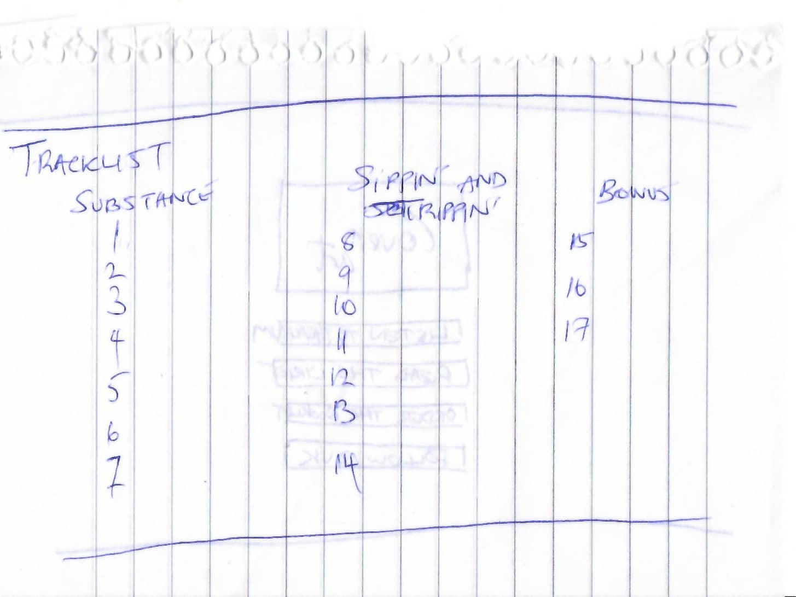

### Track page

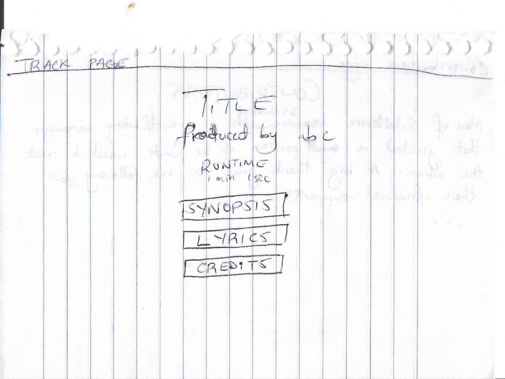

## Screenshots

### Desktop version

#### Home page

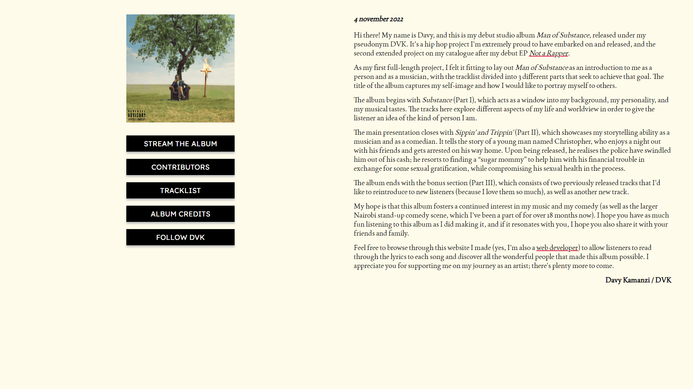

#### Contributors page

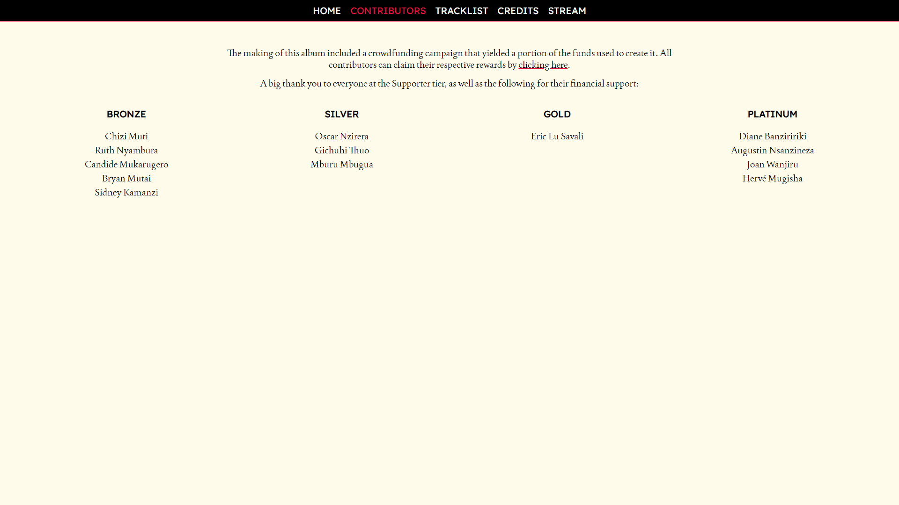
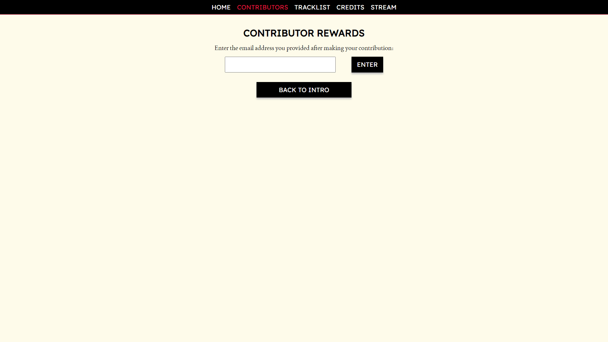

#### Tracklist page

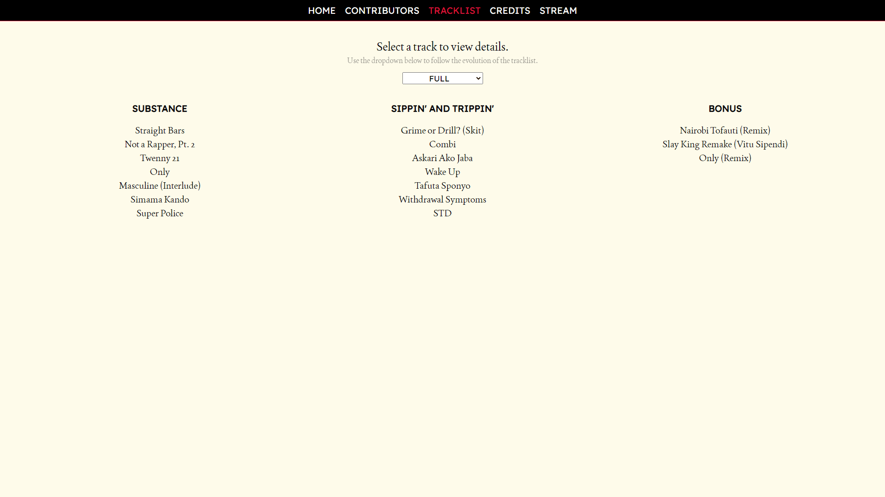

#### Track page

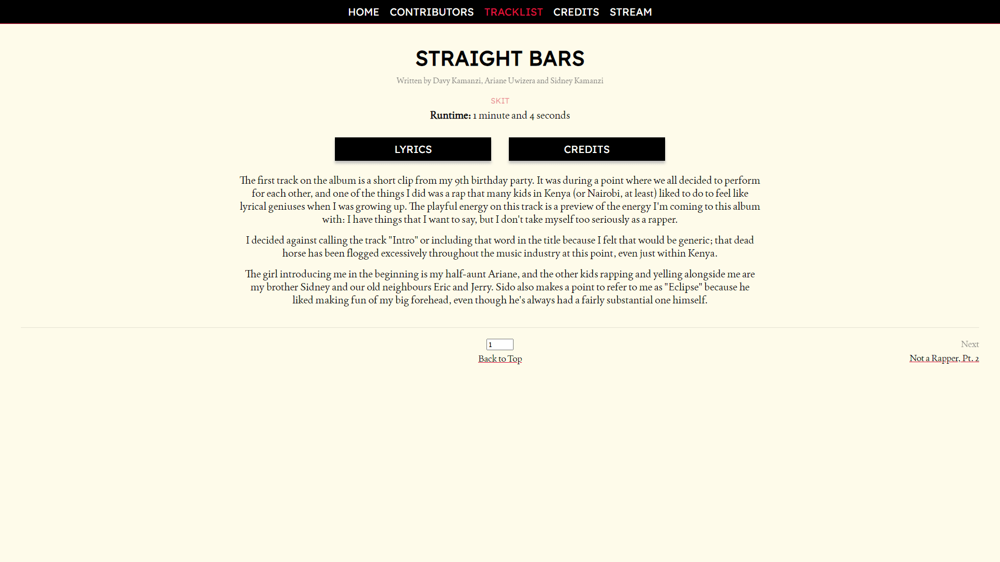

#### Credits page

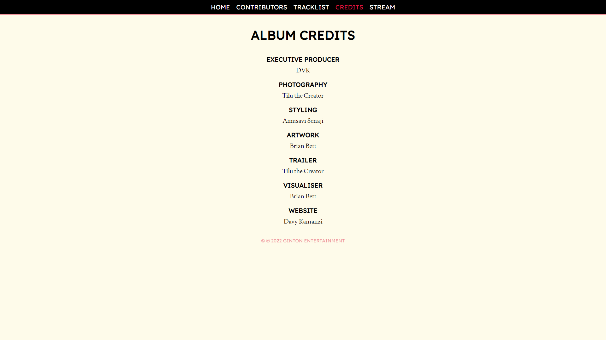

### Mobile version

#### Home page

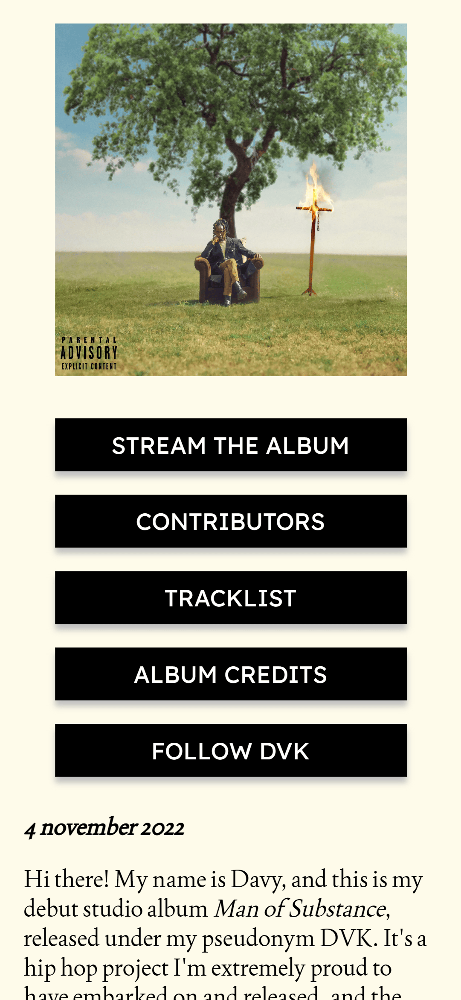

#### Contributors page

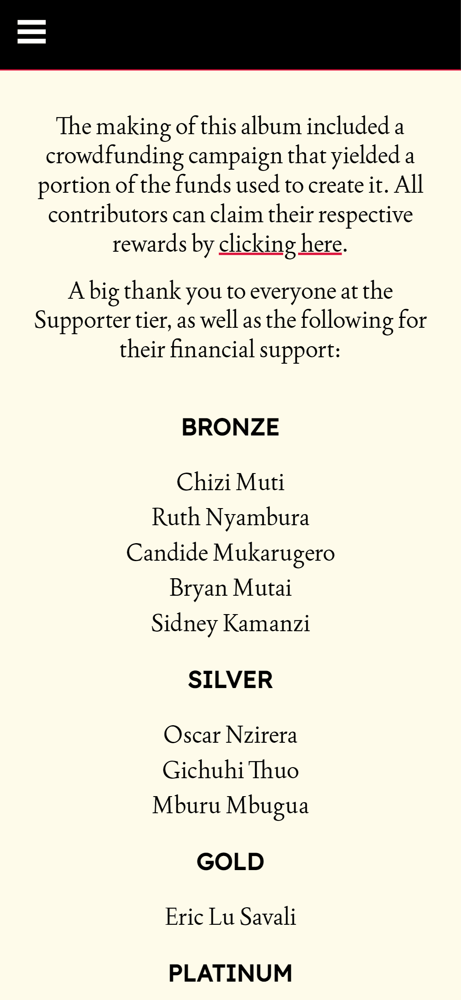

#### Tracklist page

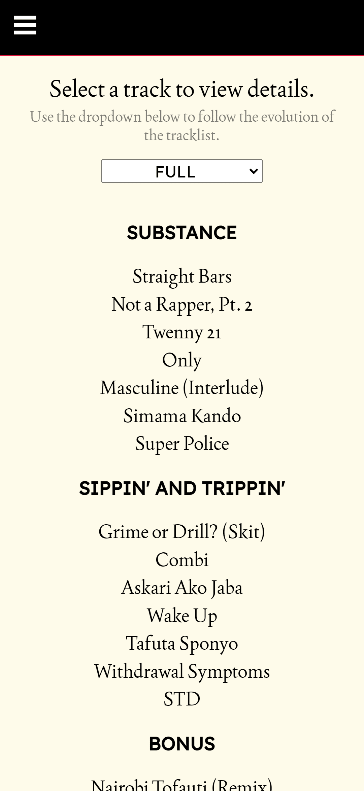

#### Track page

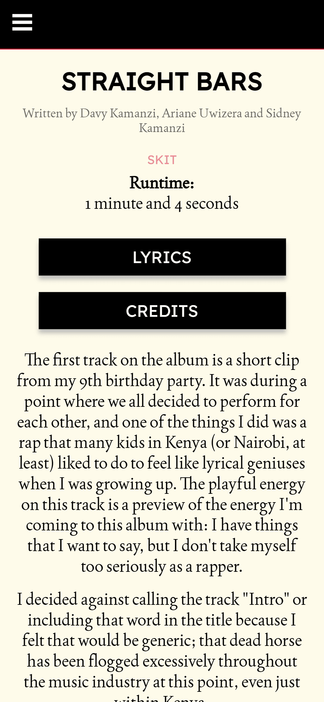

#### Credits page

## Future work

- Playwright tests for the locked and unlocked content states (`e2e/locked`, `e2e/unlocked`)
- Optional Svelte 5 migration

## Author

- GitHub: [@DavyK17](https://github.com/DavyK17) · [profile index](https://github.com/DavyK17/profile)
- Website: [davyk17.pages.dev](https://davyk17.pages.dev)
